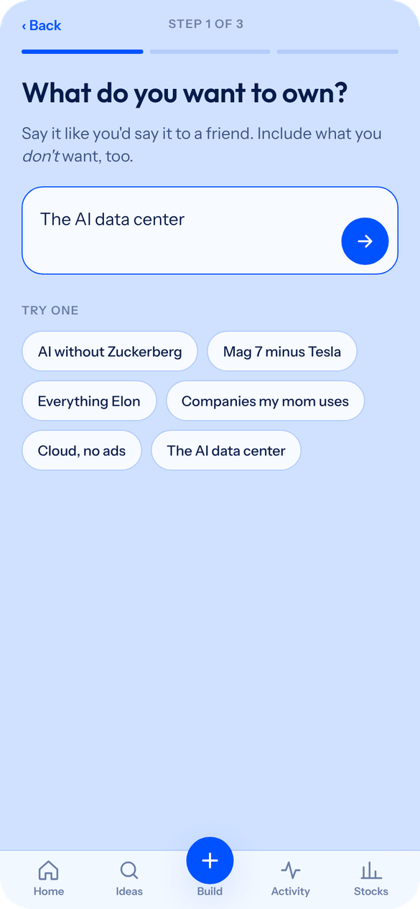
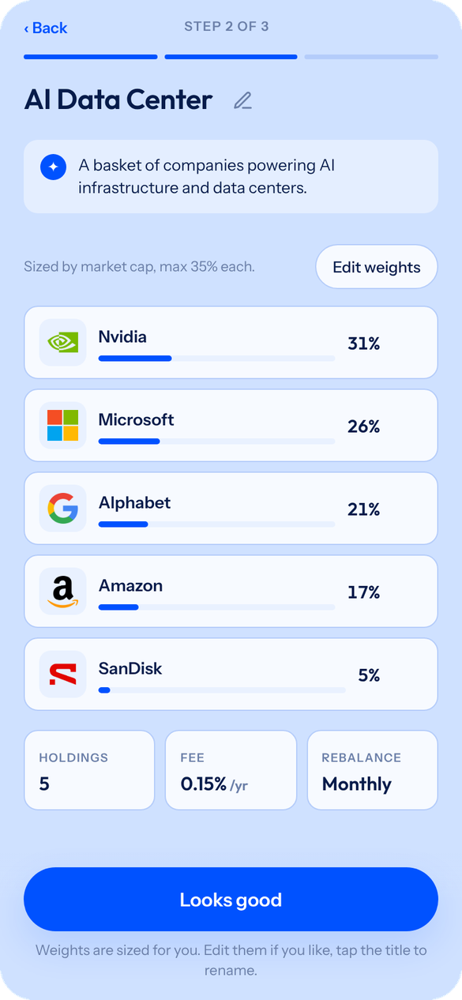
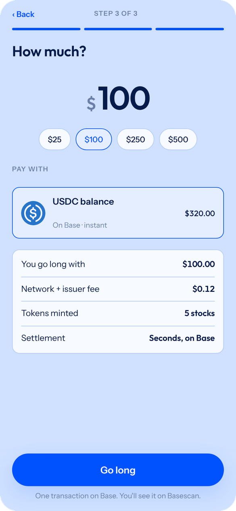
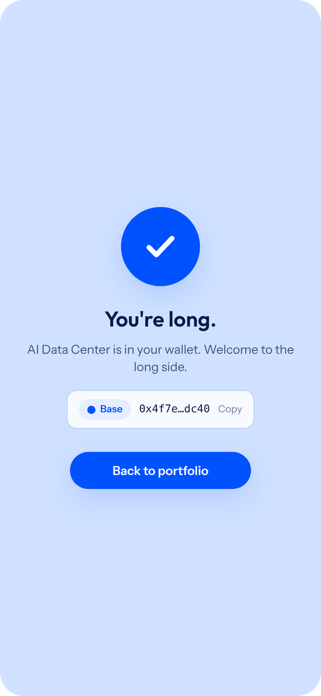
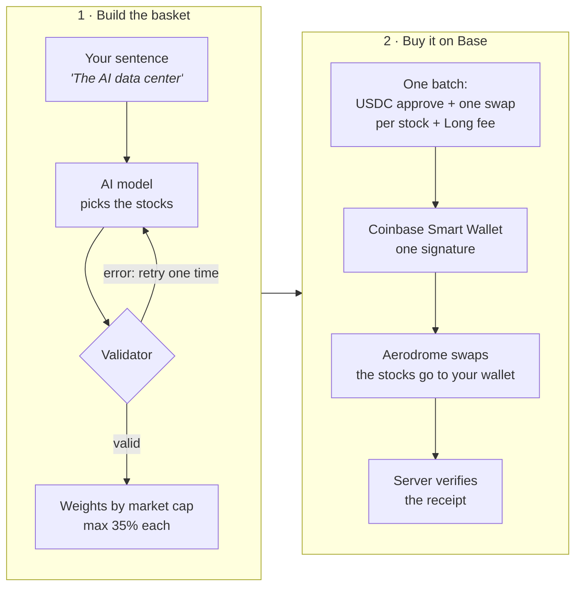
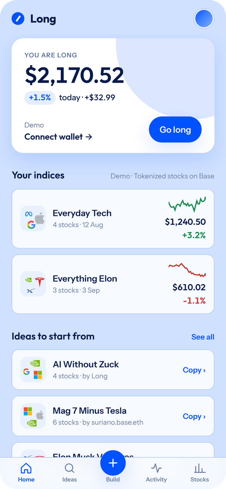
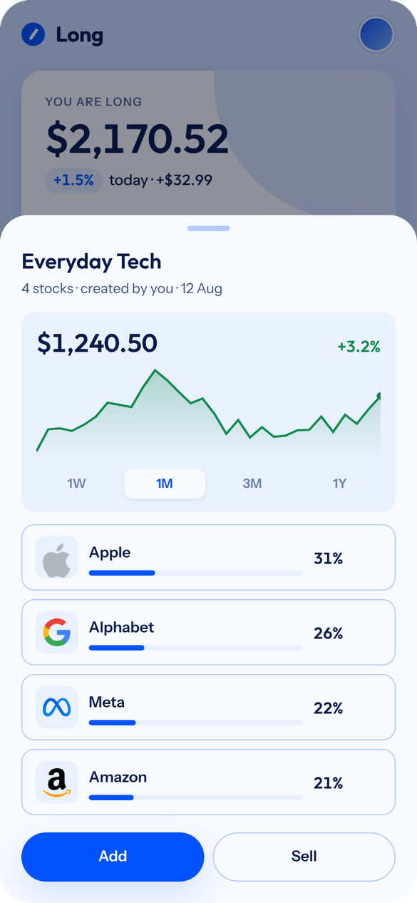
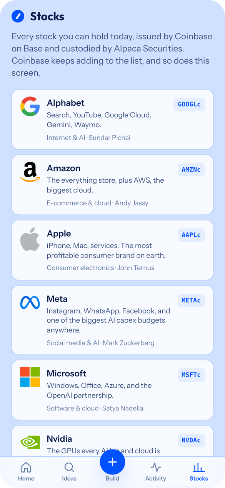

<p align="center">
  
</p>

<h1 align="center">Long</h1>

<p align="center">
  <b>Go long on what you believe in.</b><br>
  Write the stocks you want to own. Long builds the index and buys it on Base in one signature.
</p>

<p align="center">
  <a href="https://long.bedrocklabs.dev">Live app</a> ·
  <a href="#how-it-works">How it works</a> ·
  <a href="#run-it-locally">Run it locally</a> ·
  <a href="docs/long-plan.md">Full plan</a>
</p>

<p align="center">
  <a href="https://github.com/rsuriano/long-public/actions/workflows/ci.yml"></a>
</p>

<table align="center">
  <tr>
    <td align="center" width="25%"></td>
    <td align="center" width="25%"></td>
    <td align="center" width="25%"></td>
    <td align="center" width="25%"></td>
  </tr>
  <tr>
    <td align="center" width="25%"><b>1. Describe it</b><br><sub>In your own words. Say what you do not want, too.</sub></td>
    <td align="center" width="25%"><b>2. Check the basket</b><br><sub>An AI model picks the stocks. You can edit the weights.</sub></td>
    <td align="center" width="25%"><b>3. Pick an amount</b><br><sub>Pay with USDC. The gas is also paid in USDC.</sub></td>
    <td align="center" width="25%"><b>4. Sign one time</b><br><sub>All the swaps go in one transaction on Base.</sub></td>
  </tr>
</table>

## What Long is

An index fund holds a fixed list of stocks that somebody else selected. Long lets you
make your own list. You write a sentence, for example "AI without Zuckerberg" or "the
companies my mom uses". Long changes the sentence into a basket of real stocks, with a
weight for each stock.

The stocks are **tokenized stocks** on [Base](https://base.org). Coinbase issues them, and
Alpaca Securities holds the real shares. Each token follows the price of one real stock.
Because the stocks are tokens, one transaction can buy all of them together.

The tokens go directly into **your wallet**. Long never holds your money or your stocks.

Facts from the first real buys on Base mainnet:

| Measure | Value |
|---|---|
| Time from sentence to basket | ~4.5 s |
| Cost of the AI for each basket | ~0.02¢ |
| Gas for a 3-stock buy | $0.016, paid in USDC |
| Signatures for a full basket | 1 |
| Stocks available today | 10 (Coinbase adds more) |

## How it works



1. **The AI does one job: it picks the names.** The model reads your sentence and the list
   of available stocks. It returns the stocks to include and the stocks to exclude.
   ([`packages/ai`](packages/ai))
2. **A deterministic validator checks the result.** Each stock must exist, and no excluded
   stock can be in the basket. If the check fails, the model gets the errors and tries
   one more time. If it fails again, you get a template basket. The screen is never
   empty.
3. **A formula calculates the weights, not the AI.** The weights follow market cap, with
   a maximum of 35% and a minimum of 5% for each stock. This is the same method as the
   Nasdaq-100. ([`packages/universe`](packages/universe))
4. **The buy is one batch.** The app makes one USDC approval, one swap for each stock on
   Aerodrome, and one transfer for the 0.5% Long fee. The wallet signs all of them
   together ([EIP-5792](https://eips.ethereum.org/EIPS/eip-5792)). If one swap fails,
   nothing executes and you spend nothing. ([`packages/execution`](packages/execution))
5. **The server verifies each buy on the chain.** It reads the transaction receipt before
   it saves your index. Thus, the app needs no login, and nobody can record a buy that
   did not occur.

## Your portfolio

<table align="center">
  <tr>
    <td align="center"></td>
    <td align="center"></td>
    <td align="center"></td>
  </tr>
  <tr>
    <td align="center"><b>Home</b><br><sub>Live value from Chainlink prices.</sub></td>
    <td align="center"><b>One index</b><br><sub>Add more, or sell 25%, 50%, or all in one signature.</sub></td>
    <td align="center"><b>Stocks</b><br><sub>Every stock you can hold today.</sub></td>
  </tr>
</table>

## What works today

- [x] Prompt → basket with an AI model, a validator, and a fallback.
- [x] Buy a full basket with one signature, on Base mainnet.
- [x] Sell part of an index, or all of it, with one signature.
- [x] Gas paid in USDC through the Coinbase paymaster. You do not need ETH.
- [x] Indices and buys saved in Postgres, verified against the chain.
- [x] US geoblock and an eligibility declaration before the first buy.
- [x] A demo mode with sample data. You can try the app without a wallet.
- [ ] Pay with ARGt (an Argentine peso stablecoin). It needs an ARGt/USDC pool on Aerodrome.
- [ ] Rebalance an index.
- [ ] The index as one token ([Reserve Index DTF](https://reserve.org)). Refer to the
      [roadmap](docs/roadmap.md).

## Stack

| Part | Technology |
|---|---|
| App | Next.js (App Router), React, TypeScript. No CSS framework |
| Wallet | Coinbase Smart Wallet (passkey), wagmi, viem, OnchainKit |
| AI | Any model on OpenRouter. The default is Gemini 2.5 Flash Lite |
| Swaps | Aerodrome Slipstream pools on Base |
| Prices | Chainlink data feeds (reference) + Aerodrome pool price (spot) |
| Database | Postgres (Neon) |
| Hosting | Vercel |
| Monorepo | pnpm + Turborepo. Tests with Vitest |

## Repository

```
apps/web             Next.js app. Routes: /, /build, /explore, /stocks, /activity,
                     /account, /i/[id], plus /api/*
packages/ai          Prompt → basket: model, validator, retry, and template fallback
packages/execution   Prices (Chainlink + Aerodrome), buy and sell plans for the batch
packages/universe    Registry of the 10 Coinbase B20 tokens on Base + basket validator
docs/                Plan, roadmap, deploy notes, and the original UX mock
```

Each package has its own README with the details.

## Run it locally

Requirements: Node 22 or later, and pnpm 10.

```bash
pnpm install
```

```bash
pnpm dev
```

Open http://localhost:3000 and select **Try the demo**. The demo uses sample data, so you
do not need a wallet or any keys.

The environment variables are in [`.env.example`](.env.example). The app starts without
them:

- Without `OPENROUTER_API_KEY`, the AI returns template baskets.
- Without `DATABASE_URL`, the app does not save indices.

To run the checks:

```bash
pnpm typecheck && pnpm test
```

For the deploy, refer to [`docs/deploy.md`](docs/deploy.md).

## Documentation

| Document | Contents |
|---|---|
| [`docs/long-plan.md`](docs/long-plan.md) | The original plan: research on Base, architecture, and decisions |
| [`docs/roadmap.md`](docs/roadmap.md) | What each version adds: v0, v1, v2 |
| [`docs/road-to-launch.md`](docs/road-to-launch.md) | The steps from the prototype to real swaps |
| [`docs/deploy.md`](docs/deploy.md) | Vercel setup, access gate, and rate limits |
| [`docs/voice.md`](docs/voice.md) | How we write the text in the app |
| [`docs/mock/index.html`](docs/mock/index.html) | The original UX mock. It is the design specification |

## Disclaimer

Long is a product interface, not a broker. It does not hold your funds. Coinbase issues
the tokenized stocks, and Alpaca Securities holds the underlying shares. Long is not
available to US persons. Nothing in this repository or in the app is investment advice.
